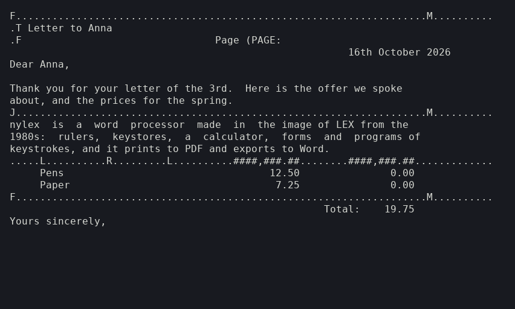
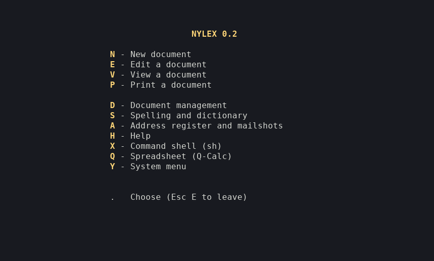

# nylex

**A word processor in the image of LEX, the 1980s word processor, for any Unix-like system.**



LEX was a word processor by Ace Microsystems Ltd, written in its own
Filetab-D language. DIAD AB sold it in Sweden as LEX-68 for DIAB's
D-NIX machines in the mid-1980s. nylex is a new program made in its
image: written from scratch after LEX's technical manual (version 9,
November 1985), with none of LEX's code in it. It was first made for
the D-NIX port to the Amiga, and builds on Linux, the BSDs, macOS and
other Unix-like systems with nothing but a C compiler.

## What it does

- **A screen editor of LEX's kind.** Control keys and Esc sequences,
  rulers with margins, tab stops, centring and number fields, justified
  paragraphs, a calculator, cut and paste, keystores and the date.
- **Menus, forms and programs.** Everything around the editor (menus,
  help pages, forms, the document index, an address register with
  lists, labels and circular letters) is made of programs of keystrokes
  kept in a system file (`.vmf`), as in LEX. It reads and writes LEX's
  documents and system files, and runs LEX-68's own `lex9a1.vmf`.
- **English and Swedish.** Two system files come with it, picked by the
  locale. Documents keep LEX-68's 7-bit Swedish (`[ \ ] { | }` for
  Ä Ö Å ä ö å) in Swedish, and Latin-1 in English.
- **Spelling.** `lexspell` checks documents, spells single words and
  finds words by pattern, with Swedish (compound words included),
  British and American English dictionaries made from LibreOffice's
  Hunspell dictionaries.
- **Printing.** PDF and PostScript, set proportionally the way a
  daisy-wheel printer with a proportional wheel set them (justified
  lines spread to the margin, tables kept in their columns), or Courier
  at LEX's 10 characters to the inch. Daisy-wheel printers with
  proportional wheels are driven from LEX-68's spacing tables.
- **Export and import.** `lexconv` turns documents into RTF, Word
  (`.docx`), OpenDocument (`.odt`), Markdown, HTML and text, and reads
  all but HTML back: paragraphs, justification, tab stops and tables,
  bold, italic and underlining, headers and footers, page breaks.



## Building

```
make                  # nylex, lexvmf, lexspell, lexconv and the dictionaries
make check            # tests in a pseudo-terminal (needs python3)
sudo make install     # to /usr/local; PREFIX=... for elsewhere
```

It needs a C89 compiler, termios, and a VT100/ANSI terminal (any
terminal emulator). python3 makes the spelling dictionaries; without
it, `make programs` builds the programs alone. [INSTALL](INSTALL) has
the details for Linux, FreeBSD, OpenBSD, NetBSD, macOS, illumos, Haiku
and older systems, plus CMake and building without make.

Tested with gcc, clang, tcc and musl on Linux x86_64, under qemu on
aarch64, arm, riscv64, powerpc, mips and s390x, and with DIAB's own C
compiler on D-NIX 5.3.

## Getting started

```
mkdir ~/letters && cd ~/letters
nylex
```

Press `N` for a new document, give it a name, a title and a
description, write, and press `Esc E` to save. `H` in the main menu has
help pages and `man nylex` lists every key. Make the terminal at least
81 columns wide, since the rulers are 80 characters.

**[doc/TUTORIAL.md](doc/TUTORIAL.md) is a 20-minute tour**: a letter with
a justified paragraph, keystores and the calculator, printed to PDF,
spell-checked, exported to Word, and address labels.

## The Swedish letters

LEX-68 kept documents in 7-bit Swedish (ISO 646-SE), where `[ \ ] { | }`
are Ä Ö Å ä ö å, and nylex keeps them so with its Swedish system file.
On the screen it translates:

```
nylex -c utf8      UTF-8 terminals (the default when the locale says UTF-8)
nylex -c latin1    ISO 8859-1 terminals
nylex -c swe7      terminals that show 7-bit Swedish themselves
```

With the English system file `[ \ ] { | }` are themselves and documents
keep Latin-1 letters (é, ü ...) as they are.

## Documentation

| File | What |
| --- | --- |
| [doc/TUTORIAL.md](doc/TUTORIAL.md) | a first tour, step by step |
| `doc/nylex.1` | the manual page: every key, menu option and print line (also `.txt` and `.pdf`) |
| `doc/lexspell.1`, `doc/lexconv.1`, `doc/lexvmf.1` | the spelling program, export and import, the system file tool |
| [doc/LEX68-NOTES.md](doc/LEX68-NOTES.md) | what was found out about LEX-68's files and behaviour |
| [INSTALL](INSTALL) | building and installing on particular systems |

## Licence

nylex, lexvmf, lexspell, lexconv, the system files and the tools are
under the MIT licence ([LICENSE](LICENSE)), copyright (c) 2026 J.Pryss.
The dictionaries in `dict/` keep their own licences (LGPL-3.0 for
Swedish, LGPL for British English, SCOWL's for American English; see
`dict/README`), and `src/pdffont.h` the notice of the Adobe font
metrics its character widths come from.

nylex is not connected with Ace Microsystems, DIAD AB or DIAB. LEX and
LEX-68 are their products and names.
